# Blender Agent Kit

**Give AI agents production-grade Blender capabilities.**

Blender Agent Kit is a headless-first Blender 5.2+ toolkit for AI agents that need to **create, modify, validate, render, and export 3D assets** through deterministic, automatable workflows.

Instead of treating Blender as a manual GUI-only tool, the kit gives an agent a structured production path:

```text
task / prompt
    ↓
create or modify geometry
    ↓
UVs · materials · textures
    ↓
LODs · collision · rigging / animation
    ↓
QA + machine-readable evidence
    ↓
review renders
    ↓
FBX / GLB / glTF / semantic bundles
    ↓
game-engine pipeline
```

The emphasis is not only on generating geometry. The goal is to let an agent produce **repeatable, inspectable, testable assets** that can survive a real production pipeline.

> Blender Agent Kit is not a neural text-to-3D or text-to-image model. Asset creation is skill-driven: an agent authors deterministic Blender/Python build logic, executes Blender headlessly, and uses the kit to validate and deliver the result.

## Independently tested — two real 3D asset workflows

**Canonical reproduction:** [`demo/README.md`](demo/README.md) documents the v0.2.3+ source-bound full/smoke entrypoints. The separate `demos/` tree is retained only as historical v0.2.1 provenance.

A separate agent installed **Blender 5.2.4 LTS** and the **unmodified Blender Agent Kit v0.2.1** release, then authored two new assets from scratch. It recorded installation friction, actual QA failures, output files, real Blender FBX round trips, and an estimated with-kit versus no-kit effort comparison. This is an **agent-authored field trial**, not a controlled benchmark or Unity Editor test.

### SupplyCrate — procedural prop, PBR, QA, LOD and collision

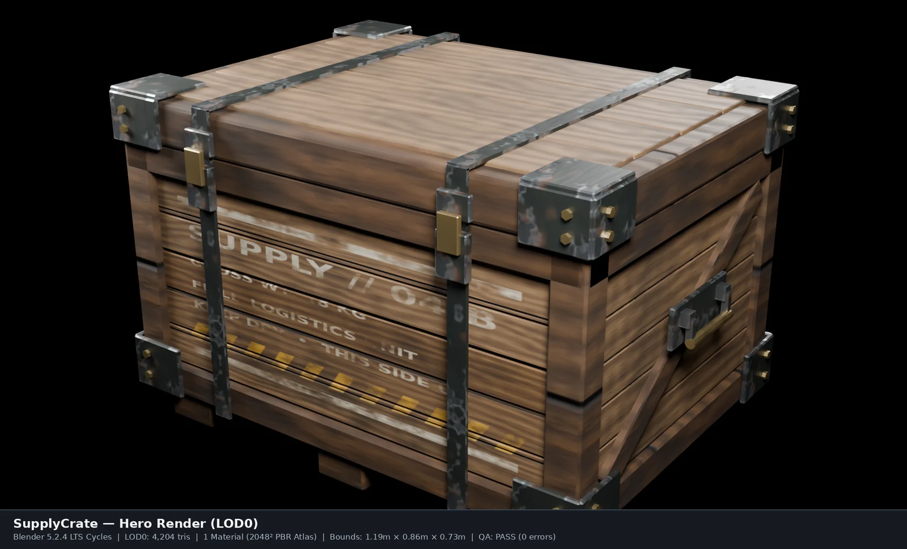

An independently authored weathered wood-and-steel prop with a **2,048² PBR atlas** and LODs of **4,204 → 1,084 → 136 triangles**. The kit's QA caught **two actual production defects** in earlier iterations: a missing common root and a **2.5 mm pivot offset**. The corrected scene reports **0 QA errors**, and all **4/4 FBX exports** passed Blender fresh-import checks.

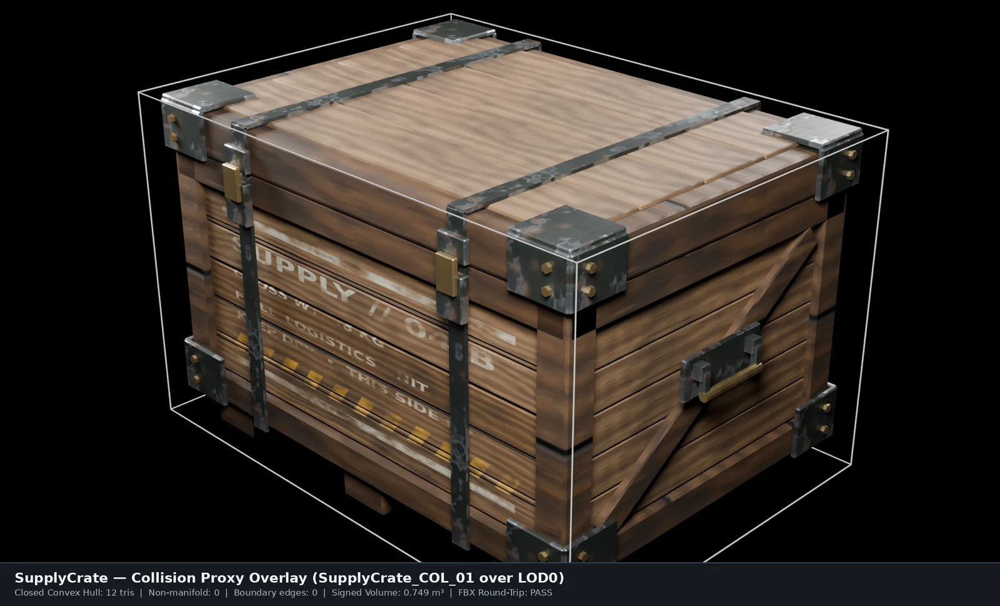

<details>
<summary><strong>View SupplyCrate technical proof: PBR → URP, LODs, orthographics, distance grid</strong></summary>

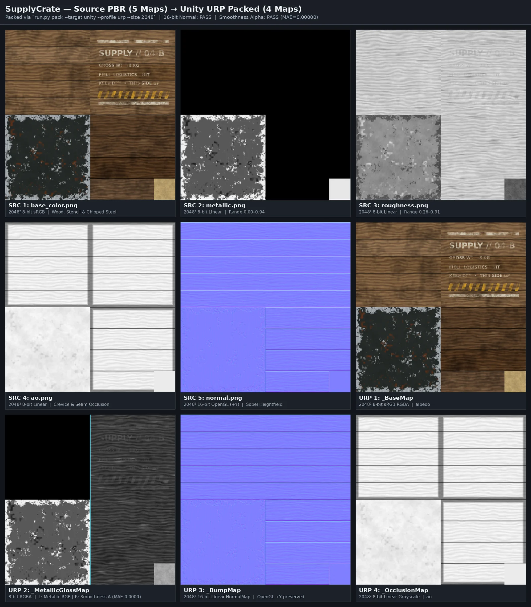

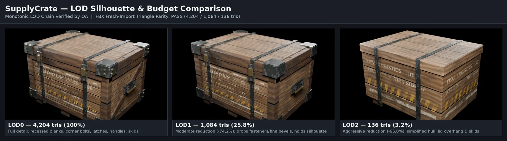

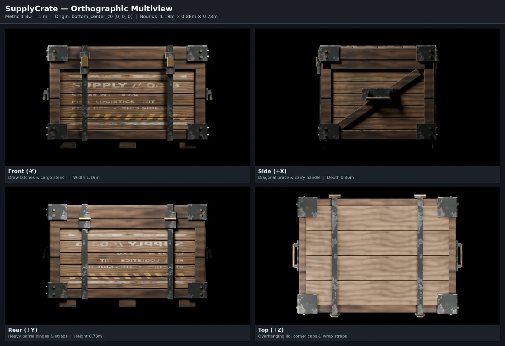

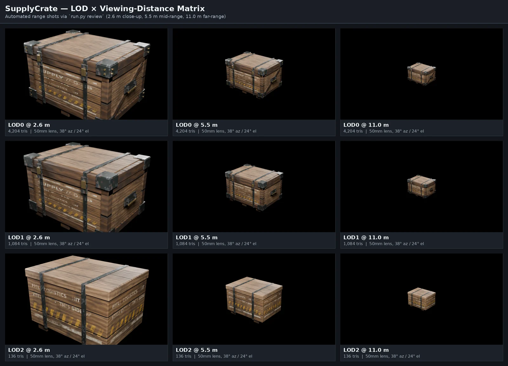

</details>

[Independent SupplyCrate source, evidence, and reproduction instructions](demo/SupplyCrate/README.md)

### Helios Conduit — modular Sci-Fi environment and hierarchy-safe export

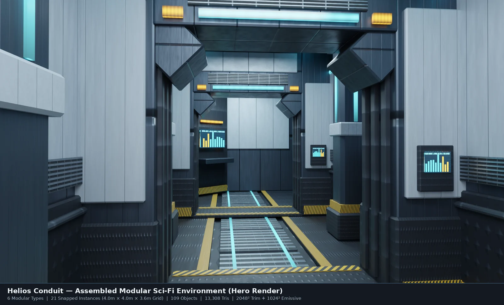

The agent created **six modular piece types** and an assembled corridor of **21 module instances, 109 objects, and 13,308 triangles**. The representative bulkhead has four LODs (**2,392 / 904 / 336 / 60 triangles**), six directional sockets, a nested hierarchy, and three walkable collision hulls. All **6/6 FBX exports** passed Blender fresh-import parity, including hierarchy and transform checks.

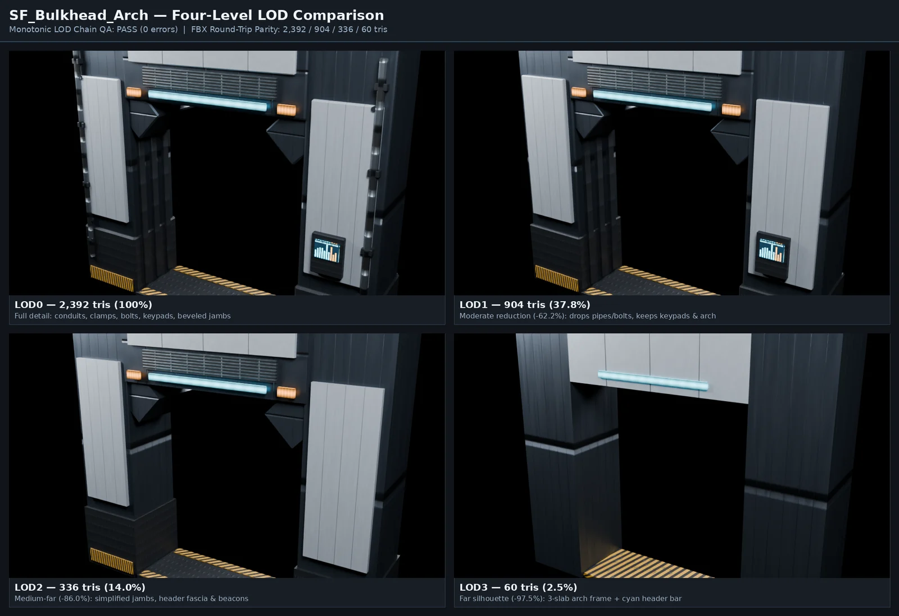

<details>
<summary><strong>View Sci-Fi technical proof: modules, collision/sockets and materials</strong></summary>

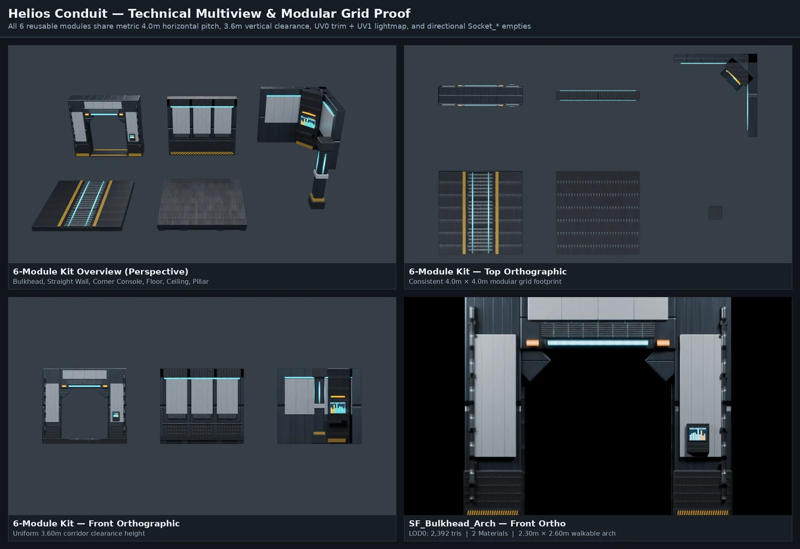

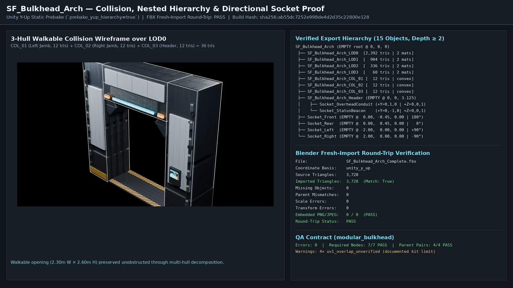

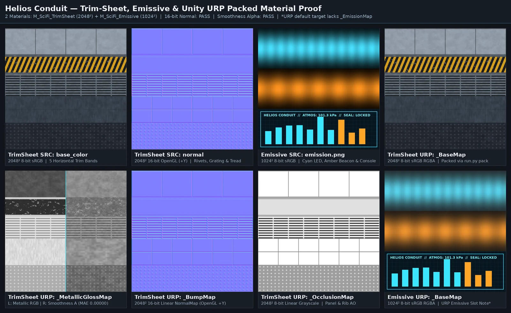

</details>

[Independent Sci-Fi source, evidence, and reproduction instructions](demo/SciFiKit/README.md)

### What the independent agent found valuable

| Real-world result | Evidence from the v0.2.1 trial |
| --- | --- |
| **Asset correctness** | QA caught an unrooted scene and 2.5 mm pivot drift; both failures and final passing reports are retained |
| **Hierarchy-safe FBX** | **10/10 exported FBXs** passed Blender fresh-import triangle parity; the bulkhead also passed parent/local-transform verification |
| **Unity URP texture preparation** | 16-bit OpenGL normal preservation and verified smoothness-from-roughness alpha packing; the SupplyCrate comparison contains all **5 source + 4 packed** maps |
| **Agent-readable automation** | Structured `inspect`, `qa`, `pack`, `bundle`, and `review` results fed the agent's technical proof sheets |
| **Review evidence** | Headless orthographic, LOD/range, and wireframe collision views reduced custom rendering work |

### Agent-reported effort savings — estimates, not benchmarks

| Scope | Estimated effort with kit | Estimated without kit | Estimated saving |
| --- | ---: | ---: | ---: |
| Pipeline engineering (setup, packing, QA, review, sheets, export) | 62 min | 238–308 min | **74–80%** |
| Combined end-to-end work (both new demos) | 148 min | 329–399 min | **55–63%** |

The agent estimated the with-kit minutes from its implementation record and estimated the no-kit baseline from required custom Blender/Python work. **These are retrospective estimates, not independently timed measurements, an A/B benchmark, or guaranteed savings.** Geometry authoring remained custom; the agent's strongest benefits were **QA, texture packing, automated rendering, and hierarchy-safe export/round-trip validation**. Its contact-sheet presentation work still required custom scripts and even added some overhead.

Read the [complete independent report](demo/REPORT.md), [capability evaluation](demo/KIT_EVALUATION.md), [effort methodology](demo/EFFORT_ANALYSIS.md), and [improvement backlog](demo/IMPROVEMENT_BACKLOG.md). No Unity Editor import was performed; the proof is based on Blender validation and documented texture checks.


---

## Blind-subagent workflow comparison — 0.48 m quadcopter

A **second, separately conducted experiment** assigned a matching 0.48 m quadcopter brief to **two fresh, reportedly isolated subagents**: Arm A used plain Blender Python (`bpy`) without being told about Blender Agent Kit or the comparison; Arm B was explicitly given the kit's skills and CLI. Both produced original Blender scenes and scripts. Afterward, the evaluator ran **the same Blender Agent Kit `solid_prop` production policy resolved for the Unity target on both scenes**, including the baseline. This is stronger isolation than the **earlier same-session exploratory experiment**, which is **not** the data shown below.

The supplied ZIP contains both Python builders, both `.blend` scenes, original renders, exported FBX files, separate audit JSON, and the kit's final QA/export reports. The plain-`bpy` builder has **no kit imports/CLI references**; the kit-guided builder contains explicit kit integration. **Fresh-subagent prompt isolation is described by the experiment report, but raw subagent prompts/transcripts or independent execution-attestation logs were not included in the submitted ZIP**, so complete absence of contextual leakage cannot be proven from these files alone.

| Observed result | Arm A: blind plain `bpy` | Arm B: Blender Agent Kit |
| --- | ---: | ---: |
| Agent turns | **8** | **13** (includes skill discovery and QA fixes) |
| Recorded Blender compute across actual runs | **376.12 s** (4 executions) | **56.49 s** (8 CLI executions) |
| Reported end-to-end elapsed time | **~15 min** | **~7.5 min** |
| Custom studio/render/export boilerplate | **150 lines** | **0 lines** (agent-classified) |
| Uniform kit `solid_prop` policy errors (Unity target) | **90 — FAIL** | **0 — PASS** |
| QA warnings | **0** | **43 `uv1_overlap_unverified`** |
| Final mesh count / triangles | **81 / 23,746** | **43 / 10,240** |
| Materials | **23** | **2** |
| Blender FBX verification | Custom round-trip reported as passed; no kit manifest | Kit fresh-import **PASS: 10,240 → 10,240 triangles** plus manifest |
| Skill reading | No explicit kit skill reads reported | Six skill documents + internal kit references; **~2,648 tokens estimated from characters**, not metered |

### Findings and trade-offs

- **QA and export readiness:** The independent uniform audit recorded **81 missing UV1**, **6 boundary-edge**, **1 triangle-budget**, **1 material-budget**, and **1 pivot-rule** error in Arm A (90 total). Arm B's initial QA found a **20-edge non-manifold GPS mast dome**; the agent fixed it, producing **zero final errors**, 43 watertight meshes and Blender FBX parity. The **43 final UV1-overlap-unverified warnings** are an explicit remaining validation limitation.
- **Execution efficiency:** The observed Blender compute total was **319.63 s (85.0%) lower**, or approximately **6.7× less**, in Arm B; the report also gives **~2× lower overall elapsed time**. The tasks shared an asset brief but **did not execute equivalent rendering or verification workloads**. Arm A invested in longer CPU Cycles studio renders, while Arm B used quicker four-view technical review rendering. This is an **observed workflow difference, not an isolated library-speed or token-efficiency benchmark**.
- **Boilerplate and agent effort:** The evaluator classified **150 lines of render/export/QA plumbing** in Arm A versus **none in Arm B**, whose script delegated these stages to kit commands. Arm B nevertheless needed **5 more agent turns** (13 vs 8) to read skills, inspect kit internals and remediate QA findings. The script-length and token figures are not model-billing measurements.
- **Presentation-quality trade-off:** Arm A's custom studio renders were reported as brighter and more presentation-ready. Arm B's fast automated review views had **darker backgrounds and less effective framing** for carbon/anodized surfaces—an actionable improvement area for review presets.
- **Different final models:** Arm A retained 23,746 triangles, 23 materials and studio objects in its source scene; Arm B produced a 10,240-triangle, two-material, single-root asset. Despite the matching brief and shared evaluation policy, this is **one pair of independent implementations**, not a repeated statistical trial or a comparison of geometrically identical assets.

**Bottom line:** In the supplied two-subagent comparison, the kit-guided arm produced a **Blender Agent Kit policy-QA-passing Blender asset for the Unity target, with structured export evidence** with less recorded Blender compute and less custom pipeline code, at the cost of more agent turns and less polished default presentation renders. These are **single-run observed outcomes**, not universally guaranteed percentage savings. The earlier independent SupplyCrate/Sci-Fi **74–80% pipeline / 55–63% end-to-end** figures remain separate *retrospective estimates*.

*Evidence provenance:* `blind_a_b_benchmark_quadcopter_assembly_in_blender_plain_bpy_vs_blender_agent_kit.html` and `quadcopter-blind-ab-assets.zip`, supplied after the earlier exploratory report. The source archive contains `arm_a_no_skill/`, `arm_b_with_skill/` and `audit/` with raw scenes, code, renders and structured checks; the full archive and HTML have **not yet been published to the repository**, so this README describes submitted evidence rather than a maintainer rerun.

---

## What can an agent do?

| Agent task | Support |
| --- | --- |
| Create procedural 3D props and modular assets from a brief | **Yes** — deterministic Blender/Python modeling workflow |
| Refine or modify an existing `.blend` scene | **Yes** |
| Create and validate LOD chains | **Yes** |
| Generate simplified collision proxies | **Yes** |
| Build pivots, hierarchies, sockets, and compound assets | **Yes** |
| Unwrap UV0 / UV1 and prepare baking workflows | **Yes** |
| Bake canonical PBR maps | **Yes** |
| Pack texture channels and resize maps deterministically | **Yes** |
| Rig articulated assets or characters | **Yes** — skill-guided workflow |
| Stage animation clips for export | **Yes** — skill-guided workflow |
| Render review / orthographic / range views | **Yes** |
| Validate geometry, LOD, UV, hierarchy, symmetry, dimensions, and budgets | **Yes** |
| Export FBX, GLB, or glTF using target-specific rules | **Yes** |
| Export one logical asset as multiple engine files | **Yes** — semantic bundles |
| Produce machine-readable QA / manifest evidence | **Yes** |
| Run repeatable headless / CI workflows | **Yes** |
| Generate arbitrary concept art from text | **No** — use an image-generation system upstream |
| Neural one-shot text-to-3D generation | **No** — this kit operates Blender deterministically |

## 3D and 2D scope

**3D asset creation is the primary product.** The modeling, LOD/collision, UV/baking, rigging/animation, review, QA, and export skills are designed to let agents operate on real Blender scenes and assets.

The kit also produces useful **2D production outputs** through Blender:

- BaseColor, Normal, Metallic, Roughness, AO, and packed texture maps;
- masks and channel-packed images;
- baked maps;
- review renders and orthographic views;
- deterministic resized/converted texture outputs.

General-purpose illustration, concept-art generation, or arbitrary text-to-image creation is intentionally outside the current scope.

## Core skill set

| Skill | Purpose |
| --- | --- |
| `blender-core` | Single entrypoint and routing for agent workflows |
| `blender-modeling` | Create/refine meshes, props, and modular kits |
| `blender-uv-baking` | UV0/UV1 workflows and canonical raw PBR baking |
| `blender-lod-collision` | LOD generation and collision proxies |
| `blender-rigging-animation` | Rigging, weights, and animation staging |
| `blender-asset-qa` | Production QA and structured evidence |
| `blender-bundle` | Compound multi-file asset delivery |
| `blender-batch` | Bounded folder-scale QA/packing/export/delivery with subprocess isolation, safe caching, and measured telemetry |
| `blender-target-unity` | Unity-specific axes, export, and texture conventions |
| project profiles | Optional reusable production policies layered over a target |

## Agent-first discovery

Before reading target/profile internals, an agent can discover the installed executable surface and resolve the production rules it must satisfy:

```bash
# Host-only: does not locate or launch Blender
python skills/core/blender-core/scripts/run.py capabilities --json

# Host-only: target -> default production policy -> optional project profile
python skills/core/blender-core/scripts/run.py contract \
  --target unity --asset-class solid_prop

# Add project/profile context only when needed
python skills/core/blender-core/scripts/run.py contract \
  --target unity --project-profile tactical-vehicle \
  --asset-class heavy_tracked_vehicle --profile tactical_urp
```

`capabilities` explicitly separates executable commands, configuration plugins, and guidance-only skills. `contract` returns units, naming/classifiers, QA/LOD/material/pivot/UV requirements, texture layout, export/round-trip behavior, and available review presets in one JSON response. This is the preferred source of truth for agent decisions; `SKILL.md` files retain only specialist guardrails that are not usefully expressed as configuration.

## Command surface

The host-facing command surface is intentionally small:

```bash
python skills/core/blender-core/scripts/run.py capabilities --json
python skills/core/blender-core/scripts/run.py contract --target unity --asset-class solid_prop
python skills/core/blender-core/scripts/run.py deliver --blend asset.blend --target unity --asset-class solid_prop --out delivery/
python skills/core/blender-core/scripts/run.py batch --operation qa --input-dir assets --target unity --asset-class solid_prop --out batch-build/
python skills/core/blender-core/scripts/run.py doctor --device auto
python skills/core/blender-core/scripts/run.py inspect --blend asset.blend
python skills/core/blender-core/scripts/run.py qa --blend asset.blend --target unity --asset-class solid_prop
python skills/core/blender-core/scripts/run.py pack --target unity --profile urp --asset-id Prop01 --material Body --input-dir raw/ --out build/
python skills/core/blender-core/scripts/run.py export --blend asset.blend --target unity --profile urp --out build/
python skills/core/blender-core/scripts/run.py bundle --blend asset.blend --spec bundle.json --target unity --out build/
python skills/core/blender-core/scripts/run.py review --blend asset.blend --device auto --out review/ 
# Optional public JSON report on any subcommand:
python skills/core/blender-core/scripts/run.py pack --target unity --profile urp --asset-id Prop01 --material Body --input-dir raw/ --out build/ --result-json build/pack.report.json
```

Asset **creation itself is performed by the agent through Blender/Python**, using the modeling and specialist skills. The commands above provide the stable runtime around creation: discovery, inspection, QA, packing, export, bundle delivery, and review evidence.

## Batch processing, caching and measured telemetry

`batch` runs bounded folder jobs without requiring an agent to write its own orchestration loop:

```bash
python skills/core/blender-core/scripts/run.py batch \
  --operation qa \
  --input-dir assets --pattern "*.blend" \
  --target unity --asset-class solid_prop \
  --out batch-build/ --result-json batch-build/report.json
```

Supported operations are `qa`, `pack`, `export`, `bundle`, and `deliver`. Blender-backed cache misses execute in separate headless processes. Cache hits are accepted only when source bytes, resolved configuration, toolkit identity, Blender identity, and operation options match; export/bundle hits also validate manifest build hashes and required generated files.

Reports contain per-asset durations plus processed/skipped/failed and cache hit/miss counts. The toolkit intentionally reports only telemetry it can observe; it does **not** estimate model/API tokens or agent turns.

Use `--refresh-cache` to rebuild known assets, `--no-cache` to disable cache use, and `--max-assets` to bound discovery.

## Architecture

```text
AI agent / developer
        ↓
Blender Agent Kit
        ↓
generic Blender core
        ↓
engine target (Unity today)
        ↓
default reusable production policy (realtime-default)
        ↓
optional project profile / external profile JSON
        ↓
downstream asset-specific builders and game contracts
```

Core mechanics stay reusable. Engine semantics belong in target plugins. Project-specific dimensions, socket inventories, content IDs, and simulation rules stay downstream.

**Policy boundary:** the Unity target now contains engine facts such as coordinate/export/URP-HDRP behavior. Generic triangle/material budgets, pivot/UV expectations, naming conventions, and LOD transition defaults live in the reusable `realtime-default` production policy. The policy is resolved automatically for backwards-compatible CLI behavior and can be overridden by a project profile.

## Quick start

```bash
# Generic core + Unity target
python tools/install.py --agent all --targets unity

# Optional project-profile skills
python tools/install.py --agent all --targets unity --packs profiles

python tools/doctor.py --device auto
python tools/run_tests.py --suite host
python tools/run_tests.py --suite core
python tools/run_tests.py --suite targets
```

## Single agent entrypoint

```bash
python skills/core/blender-core/scripts/run.py doctor --device auto

python skills/core/blender-core/scripts/run.py inspect \
  --blend asset.blend

python skills/core/blender-core/scripts/run.py qa \
  --blend asset.blend --target unity --asset-class solid_prop

python skills/core/blender-core/scripts/run.py pack \
  --target unity --profile urp \
  --asset-id Prop01 --material Body \
  --input-dir raw/ --size 2048 --detect-normal-y \
  --out build/

python skills/core/blender-core/scripts/run.py export \
  --blend asset.blend --target unity --profile urp --out build/

python skills/core/blender-core/scripts/run.py bundle \
  --blend vehicle.blend --spec bundle.json --target unity --out build/

python skills/core/blender-core/scripts/run.py review \
  --blend asset.blend --device auto --out review/
```

## Production capabilities in v0.2

Compared with v0.1, v0.2 adds:

- strict Blender 5.2+ discovery and doctor behavior;
- strict Draft 2020-12 JSON Schema checks in CI;
- generic scene inventory shared by QA/export/evidence;
- fail-closed QA for empty scenes and malformed geometry;
- aggregate LOD/material budgets and LOD reduction ratios;
- intact-vs-`Damage_*` triangle accounting with configurable allowed LODs;
- configurable L/R mirror checks using triangle counts, mirrored bounds, and signed-volume magnitudes;
- configurable semantic dimension boxes, including optional LOD scoping and exclude patterns;
- profile-driven LOD aggregation exclusions for variant/collision hierarchies in multi-LOD authoring scenes;
- configurable UV-range/V-scroll checks, including per-face U-band selection for merged atlases;
- safe 8/16-bit channel packing plus Lanczos resizing via `--size`;
- optional normal-Y convention reporting, explicitly marked heuristic;
- hierarchy-safe static FBX Y-up prebaking for nested pivots and directional socket empties;
- optional temporary LOD-suffix stripping for multi-LOD authoring scenes, with collision-safe name stashing/restoration;
- zero-root export for selected compound parts;
- FBX embedded-image magic-header checks;
- semantic multi-file bundle export with authoring and export-coordinate inventories;
- stronger Blender fresh-import comparison;
- deterministic build hashes including tool/config identity;
- profile-driven review presets with close-up, 50/150/400m shots, per-LOD views, damage views, collision outline, and reference-FBX silhouette comparison;
- optional `tactical-vehicle` profile demonstrating reusable tracked-vehicle conventions without modifying the base Unity target.

## Unity static hierarchy export

For static MESH/EMPTY hierarchies, the Unity target uses:

```json
{
  "use_space_transform": false,
  "prebake_yup_hierarchy": true,
  "prebake_directional_patterns": ["Socket_*"],
  "apply_transform_static": false
}
```

This avoids Blender FBX `bake_space_transform` on nested hierarchies.

The exporter converts the authored Blender Z-up basis into a Unity-friendly Y-up/+Z-forward basis before FBX export:

- positions are transformed by `Rx(-90°)`;
- ordinary transform frames use a basis change `C · R · C⁻¹`;
- directional empties matching `prebake_directional_patterns` use `C · R`, preserving their authored forward/up vectors;
- mesh-local vertices are transformed by `C`;
- local matrices are reconstructed from converted world matrices, preserving depth ≥ 2 parent chains.

The authoring scene is restored immediately after export.

Blender's FBX importer shows a +90° X root wrapper when re-importing a Y-up FBX back into Blender's Z-up viewport. The generic round-trip verifier accounts for that importer presentation while verifying child local transforms, hierarchy, scale, triangle count, and embedded-image absence.

The prebake is intentionally **static-only**. Rigged/armature exports remain on the configured rigged FBX path and are not mutated by the static hierarchy conversion.

## Project profiles

A project profile is an in-memory overlay over an engine target. It can add:

- QA asset classes and budgets;
- naming rules;
- custom texture packing profiles;
- damage conventions;
- mirror/dimension/UV rules;
- bundle defaults;
- review presets.

The stored base target is never mutated.

The optional built-in profile is:

```text
plugins/profiles/blender-profile-tactical-vehicle/
```

It demonstrates reusable production conventions:

- heavy/light tracked vehicle LOD budgets;
- ≤ 0.50 reduction per LOD step;
- `Damage_*` permitted only in LOD0/LOD1;
- ground-contact checks;
- optional turret/gun hierarchy checks;
- BaseColor + Normal + Mask packing;
- profile-driven `station`/`kit` zero-root defaults;
- tactical review preset:
  - 1280×720;
  - 12m close-up;
  - 50m, 150m, 400m;
  - LOD0–3;
  - damage views;
  - collision outline.

Exact game-specific dimensions, socket inventories, simulation rules, faction/contact knowledge, content IDs, or prefab logic belong in downstream profile files.

### Minimal external profile example

A project-specific profile overlays a target in memory; it does not modify the generic toolkit or Unity target file. Save this as `project-profile.json` alongside your asset:

```json
{
  "name": "example-prop",
  "version": "1.0.0",
  "target_overrides": {
    "unity": {
      "qa": {
        "common": {"lod_exclude_patterns": ["*_COL_*"]},
        "asset_classes": {
          "example_prop": {
            "pivot_rule": "bottom_center_z0",
            "max_material_slots": 2,
            "required_parent_pairs": [
              {"child": "Socket_Front", "parent": "AssetRoot"}
            ]
          }
        }
      }
    }
  },
  "review_presets": {
    "hero": {
      "resolution": [1280, 720],
      "orthographic_views": ["front", "side", "top"],
      "primary_lod": 0,
      "collision_view": true
    }
  }
}
```

Use `--project-profile project-profile.json --asset-class example_prop` for QA, or `--preset hero` for review. Parent relationships use **objects with `child` and `parent` strings**, not positional arrays. The common collider exclusion is now automatic for recognized collision meshes; retaining the explicit example is supported for portability to older toolkit releases.

For Linux/macOS, use `python3` if `python` is not on `PATH`. If Blender was extracted to a nonstandard directory, set `BLENDER_EXECUTABLE=/absolute/path/to/blender` before invoking doctor or a subcommand. Run `run.py qa --help`, `run.py pack --help`, and similar commands to discover the exact accepted flags without starting Blender.

## Semantic bundle export

A bundle represents one logical asset that produces multiple engine files.

```json
{
  "schema_version": "1.0",
  "asset_id": "Vehicle01",
  "parts": [
    {
      "id": "chassis_lod0",
      "role": "chassis",
      "lod": 0,
      "collection": "Chassis_LOD0",
      "file": "Vehicle01_Chassis_LOD0.fbx"
    },
    {
      "id": "station_lod0",
      "role": "station",
      "lod": 0,
      "root": "Vehicle01_Station",
      "file": "Vehicle01_Station_LOD0.fbx",
      "zero_root_location": true
    }
  ]
}
```

Each part can be selected by exactly one collection or root hierarchy.

Downstream profiles can opt into temporary authoring-name normalization:

```json
{
  "export": {
    "strip_lod_suffix_on_export": true,
    "strip_lod_suffix_pattern": "_LOD[0-9]+$"
  }
}
```

When enabled, selected names such as `Turret_Pivot_LOD1` are exported as `Turret_Pivot`. Any unselected object already owning the base name is temporarily moved to an internal stash name; all selected and unselected names are restored after export. The exporter fails instead of guessing if stripping would create duplicate names inside the selected part.

The exporter records both:

- `assembly_inventory` — the authored assembled position;
- `inventory` — the actual export-coordinate state, including zeroed part roots when requested.

For every part it also records:

- total/intact/damage triangles;
- material counts;
- hierarchy and roots;
- Blender fresh-import result;
- child transform comparison;
- zero-root result;
- FBX PNG/JPEG magic-header scan.

`zero_root_location` is explicit and generic. Optional project profiles can declare `bundle_defaults.zero_root_location_roles` such as `station` and `kit`; the generic core itself does not assign meanings to role strings.

## QA

Implemented generic checks include:

- at least one mesh;
- applied/negative scale;
- non-manifold and boundary edges;
- inward closed-mesh winding using signed volume;
- UV0 and requested UV1 presence;
- aggregate per-LOD triangle/material budgets;
- monotonic LOD counts and maximum ratios;
- separate intact/damage triangle evidence;
- configurable damage-prefix and allowed-damage-LOD policy;
- required nodes and parent relationships;
- ground-axis contact tolerance;
- maximum vertex-group influences;
- simple bottom-center pivots;
- configurable mirror-pair checks;
- configurable semantic dimension boxes;
- configurable per-object/per-LOD UV bounds and V-span checks.

QA returns structured `evidence.symmetry`, `evidence.dimensions`, and `evidence.uv` data so downstream delivery tools do not need to parse prose.

### Explicit limitations

The pipeline does **not** yet prove:

- geometric UV-island non-overlap;
- texel density;
- collider convexity/decomposition quality;
- complete engine-side prefab/LODGroup construction.

When non-overlapping UV1 is requested, UV1 presence is enforced and the limitation is emitted as `uv1_overlap_unverified`.

## Texture packing

`shared/channel_pack` accepts allowlisted channel expressions such as:

```text
base_color.r
metallic
1-roughness
normal.g
```

No `eval()` is used.

`--size N` Lanczos-resamples every loaded raw map to `N×N` before packing, so different source resolutions can feed deterministic material outputs. Without `--size`, mismatched raw-map dimensions fail explicitly.

`--detect-normal-y` reports a green-channel directional-bias heuristic:

```json
{
  "convention": "opengl",
  "heuristic_only": true,
  "mean_green": 0.63,
  "confidence": 0.52
}
```

Pixel statistics cannot mathematically prove a tangent-space normal convention, so downstream pipelines should retain source/build evidence when available.

## Review rendering

Review behavior is now split into reusable **styles** and project-specific **presets**.

The default `realtime-default` production policy provides:

- **`technical`** — headless-safe low-sample Cycles, bright neutral background, high-contrast deterministic lighting, tighter framing, and fast inspection-oriented output;
- **`showcase`** — higher-sample Cycles with presentation-oriented background, lighting, lens, and framing.

Render engine, samples, background, hero distance/lens, orthographic scale, and light placement/energy are policy/configuration values rather than hidden code constants. Eevee can be selected by a custom style where a graphics/EGL stack is available, but the default technical style remains Cycles for reliable headless CI.

A project profile can overlay either style with a `review_preset` containing asset/project-specific views, LODs, ranges, damage/exclusion rules, collision views, and reference FBX.

```bash
# Fast technical evidence
python skills/core/blender-core/scripts/run.py review \
  --blend asset.blend --target unity --style technical --out review/

# Higher-quality presentation render
python skills/core/blender-core/scripts/run.py review \
  --blend asset.blend --target unity --style showcase --out showcase/
```

The resolved review contract is discoverable without Blender:

```bash
python skills/core/blender-core/scripts/run.py contract \
  --target unity --asset-class solid_prop --style technical
```

### QA-gated delivery

For a source-ready `.blend`, `deliver` reuses the existing commands in a fail-closed sequence:

```text
inspect -> QA gate -> optional pack -> review -> export/bundle -> round-trip verification
```

By default, **review and export do not run when QA fails**. The JSON report records every stage result and duration, whether the QA gate passed, and the recommended rerun point.

```bash
python skills/core/blender-core/scripts/run.py deliver \
  --blend asset.blend \
  --target unity --asset-class solid_prop \
  --asset-id Prop01 \
  --review-style technical \
  --out delivery/ \
  --result-json delivery/report.json
```

Use `--bundle-spec` for semantic bundles. Texture packing is opt-in via `--pack-input-dir` because canonical raw texture inputs/material identity must be explicit. `--continue-on-qa-error` exists as an intentional diagnostic override; normal delivery should leave the gate enabled.

## Generic review contact sheets

Use the separate, host-side `tools/review_compose.py` after rendering; this stage uses Pillow and does **not** require starting Blender. A data-driven specification can compose a multi-view sheet, LOD strip, distance grid, or collision comparison without hardcoded prop/vehicle/game assumptions.

```json
{
  "schema_version": "1.0",
  "columns": 2,
  "tile_size": [480, 270],
  "tiles": [
    {"path": "review_hero.png", "label": "Hero"},
    {"path": "review_front.png", "label": "Front"},
    {"path": "review_lod0_3m.png", "label": "LOD0", "evidence": "Triangles: supply from QA"},
    {"path": "review_collision_outline.png", "label": "Collision overlay"}
  ]
}
```

```bash
python tools/review_compose.py --spec review/sheet.json --out review/contact.webp
```

Labels and counts are supplied by the caller; the compositor never invents geometry or QA metrics. Missing or completely flat input images fail by default. Pillow is an optional host dependency for this step.

## Unity helper boundary

The optional `BlenderAssetPostprocessor.cs` remains a generic import helper for standard URP/HDRP assets. It deterministically binds manifests to importing assets and configures model/texture/material settings.

It does **not** own project-specific:

- prefab construction;
- LODGroup construction;
- collision policy;
- custom packed-mask shaders;
- content registration;
- ViewBinding or simulation state.

A downstream project may use a separate scratch-Unity verifier against bundle evidence without contaminating the generic Unity target.

## Documentation

- [DESIGN.md](DESIGN.md)
- [Unity target](plugins/targets/blender-target-unity/SKILL.md)
- [Asset QA](skills/core/blender-asset-qa/SKILL.md)
- [Semantic bundle export](skills/core/blender-bundle/SKILL.md)
- [Tactical vehicle profile](plugins/profiles/blender-profile-tactical-vehicle/SKILL.md)

## License

MIT — see [LICENSE](LICENSE).
