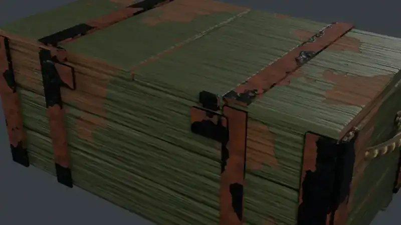
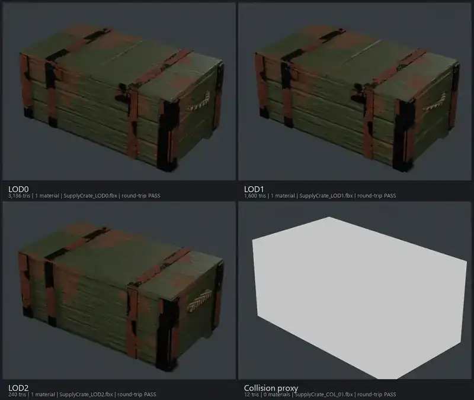
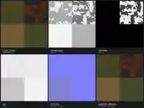
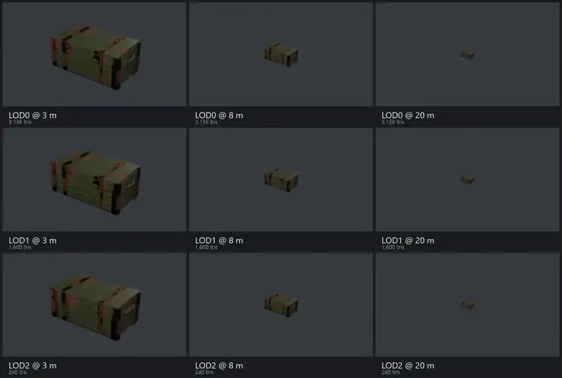
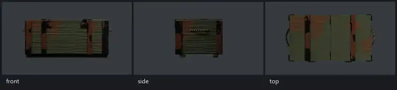
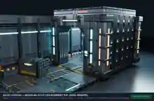
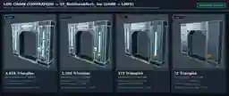

# Blender Agent Kit

**Give AI agents production-grade Blender capabilities.**

Blender Agent Kit is a headless-first Blender 5.2+ toolkit for AI agents that need to **create, modify, validate, render, and export 3D assets** through deterministic, automatable workflows.

Instead of treating Blender as a manual GUI-only tool, the kit gives an agent a structured production path:

```text
task / prompt
    ↓
create or modify geometry
    ↓
UVs · materials · textures
    ↓
LODs · collision · rigging / animation
    ↓
QA + machine-readable evidence
    ↓
review renders
    ↓
FBX / GLB / glTF / semantic bundles
    ↓
game-engine pipeline
```

The emphasis is not only on generating geometry. The goal is to let an agent produce **repeatable, inspectable, testable assets** that can survive a real production pipeline.

> Blender Agent Kit is not a neural text-to-3D or text-to-image model. Asset creation is skill-driven: an agent authors deterministic Blender/Python build logic, executes Blender headlessly, and uses the kit to validate and deliver the result.

## Showcase — SupplyCrate

> **Task:** Create a weathered supply crate with procedural PBR textures, three LODs, a collision proxy, QA evidence, automated review renders, and Unity-target export.



This is a **real, reproducible demo produced through Blender Agent Kit**, not a mockup.

- Procedural geometry plus a 2048² PBR atlas
- LOD0 **3,136 tris** → LOD1 **1,600** → LOD2 **240**
- **12-triangle** collision proxy
- QA: **PASS**, 0 errors
- 4 FBX parts: Blender fresh-import / round-trip **PASS**, no embedded images
- Unity URP texture packing
- Rebuild locally with `python demos/SupplyCrate/run_demo.py`

[Demo source + instructions](demos/SupplyCrate/README.md) · [Compact evidence](demos/SupplyCrate/evidence/summary.json)

| LOD + collision output | PBR source → Unity URP packing |
| --- | --- |
|  |  **Historical six-tile evidence**, provided from the source ZIP. A newly regenerated nine-map image remains pending. The original reportedly blank WebP is no longer embedded. |

<details>
<summary><strong>Automated review evidence</strong></summary>





</details>

The checked-in SupplyCrate rendering contact sheets record the demonstrated source run. The original six-tile texture proof image was supplied separately; the broken texture WebP is excluded from this README pending an evidence-grounded rebuild. The generic collision-review renderer has since been upgraded to overlay collision wireframes over the primary LOD, so fresh reruns use the clearer overlay view.

## Showcase 2 — Sci-Fi modular kit (independent agent trial)





*These deliberately compact preview WebPs were resized from the independent agent's actual proof images, not rendered or painted anew. The original full-resolution images are retained in the supplied archive, not committed to Git.*


The **Aegis Station** modular environment kit is a second, materially different trial of the Blender Agent Kit workflow. An independent agent supplied editable Blender scenes, a deterministic builder script, a 60-object modular assembly, QA/export/packing JSON, a bulkhead FBX, raw and packed textures, and five rendered proof images. We inspected the supplied archive and machine reports; this is not a newly rerun build.

The bulkhead's four visible LOD meshes have **3,628 / 1,260 / 372 / 72 triangles**. Its QA report records **zero errors** (plus four explicit UV1 overlap-unverified warnings), while its **5,380-triangle** complete FBX hierarchy passed Blender fresh-import parity with no embedded images. The 1024² URP packing report records all four standard slots, including a **16-bit normal map**.

[Read the archive-based Sci-Fi evidence assessment](demos/SciFiKit/README.md) · [Structured summary](demos/SciFiKit/evidence/summary.json)

The agent also reported that LOD manifold checks, material budgets, and pivot checks helped catch earlier authoring errors. Its productivity-savings numbers are **subjective feedback, not measured benchmarks**. The submitted source archive and five original proof sheets were inspected independently; their original reports remain attributed to the agent. **A clean public rerun and committed lightweight visual gallery are planned for a later showcase improvement**, not claimed by this patch.

## What can an agent do?

| Agent task | Support |
| --- | --- |
| Create procedural 3D props and modular assets from a brief | **Yes** — deterministic Blender/Python modeling workflow |
| Refine or modify an existing `.blend` scene | **Yes** |
| Create and validate LOD chains | **Yes** |
| Generate simplified collision proxies | **Yes** |
| Build pivots, hierarchies, sockets, and compound assets | **Yes** |
| Unwrap UV0 / UV1 and prepare baking workflows | **Yes** |
| Bake canonical PBR maps | **Yes** |
| Pack texture channels and resize maps deterministically | **Yes** |
| Rig articulated assets or characters | **Yes** — skill-guided workflow |
| Stage animation clips for export | **Yes** — skill-guided workflow |
| Render review / orthographic / range views | **Yes** |
| Validate geometry, LOD, UV, hierarchy, symmetry, dimensions, and budgets | **Yes** |
| Export FBX, GLB, or glTF using target-specific rules | **Yes** |
| Export one logical asset as multiple engine files | **Yes** — semantic bundles |
| Produce machine-readable QA / manifest evidence | **Yes** |
| Run repeatable headless / CI workflows | **Yes** |
| Generate arbitrary concept art from text | **No** — use an image-generation system upstream |
| Neural one-shot text-to-3D generation | **No** — this kit operates Blender deterministically |

## 3D and 2D scope

**3D asset creation is the primary product.** The modeling, LOD/collision, UV/baking, rigging/animation, review, QA, and export skills are designed to let agents operate on real Blender scenes and assets.

The kit also produces useful **2D production outputs** through Blender:

- BaseColor, Normal, Metallic, Roughness, AO, and packed texture maps;
- masks and channel-packed images;
- baked maps;
- review renders and orthographic views;
- deterministic resized/converted texture outputs.

General-purpose illustration, concept-art generation, or arbitrary text-to-image creation is intentionally outside the current scope.

## Core skill set

| Skill | Purpose |
| --- | --- |
| `blender-core` | Single entrypoint and routing for agent workflows |
| `blender-modeling` | Create/refine meshes, props, and modular kits |
| `blender-uv-baking` | UV0/UV1 workflows and canonical raw PBR baking |
| `blender-lod-collision` | LOD generation and collision proxies |
| `blender-rigging-animation` | Rigging, weights, and animation staging |
| `blender-asset-qa` | Production QA and structured evidence |
| `blender-bundle` | Compound multi-file asset delivery |
| `blender-batch` | Folder-scale headless processing and build caching |
| `blender-target-unity` | Unity-specific axes, export, and texture conventions |
| project profiles | Optional reusable production policies layered over a target |

## Command surface

The host-facing command surface is intentionally small:

```bash
python skills/core/blender-core/scripts/run.py doctor --device auto
python skills/core/blender-core/scripts/run.py inspect --blend asset.blend
python skills/core/blender-core/scripts/run.py qa --blend asset.blend --target unity --asset-class solid_prop
python skills/core/blender-core/scripts/run.py pack --target unity --profile urp --asset-id Prop01 --material Body --input-dir raw/ --out build/
python skills/core/blender-core/scripts/run.py export --blend asset.blend --target unity --profile urp --out build/
python skills/core/blender-core/scripts/run.py bundle --blend asset.blend --spec bundle.json --target unity --out build/
python skills/core/blender-core/scripts/run.py review --blend asset.blend --device auto --out review/\n# Optional public JSON report on any subcommand:\npython skills/core/blender-core/scripts/run.py pack --target unity --profile urp --asset-id Prop01 --material Body --input-dir raw/ --out build/ --result-json build/pack.report.json
```

Asset **creation itself is performed by the agent through Blender/Python**, using the modeling and specialist skills. The commands above provide the stable runtime around creation: discovery, inspection, QA, packing, export, bundle delivery, and review evidence.

## Architecture

```text
AI agent / developer
        ↓
Blender Agent Kit
        ↓
generic Blender core
        ↓
engine target (Unity today)
        ↓
optional reusable project profile / external profile JSON
        ↓
downstream asset-specific builders and game contracts
```

Core mechanics stay reusable. Engine semantics belong in target plugins. Project-specific dimensions, socket inventories, content IDs, and simulation rules stay downstream.

## Quick start

```bash
# Generic core + Unity target
python tools/install.py --agent all --targets unity

# Optional project-profile skills
python tools/install.py --agent all --targets unity --packs profiles

python tools/doctor.py --device auto
python tools/run_tests.py --suite host
python tools/run_tests.py --suite core
python tools/run_tests.py --suite targets
```

## Single agent entrypoint

```bash
python skills/core/blender-core/scripts/run.py doctor --device auto

python skills/core/blender-core/scripts/run.py inspect \
  --blend asset.blend

python skills/core/blender-core/scripts/run.py qa \
  --blend asset.blend --target unity --asset-class solid_prop

python skills/core/blender-core/scripts/run.py pack \
  --target unity --profile urp \
  --asset-id Prop01 --material Body \
  --input-dir raw/ --size 2048 --detect-normal-y \
  --out build/

python skills/core/blender-core/scripts/run.py export \
  --blend asset.blend --target unity --profile urp --out build/

python skills/core/blender-core/scripts/run.py bundle \
  --blend vehicle.blend --spec bundle.json --target unity --out build/

python skills/core/blender-core/scripts/run.py review \
  --blend asset.blend --device auto --out review/
```

## Production capabilities in v0.2

Compared with v0.1, v0.2 adds:

- strict Blender 5.2+ discovery and doctor behavior;
- strict Draft 2020-12 JSON Schema checks in CI;
- generic scene inventory shared by QA/export/evidence;
- fail-closed QA for empty scenes and malformed geometry;
- aggregate LOD/material budgets and LOD reduction ratios;
- intact-vs-`Damage_*` triangle accounting with configurable allowed LODs;
- configurable L/R mirror checks using triangle counts, mirrored bounds, and signed-volume magnitudes;
- configurable semantic dimension boxes, including optional LOD scoping and exclude patterns;
- profile-driven LOD aggregation exclusions for variant/collision hierarchies in multi-LOD authoring scenes;
- configurable UV-range/V-scroll checks, including per-face U-band selection for merged atlases;
- safe 8/16-bit channel packing plus Lanczos resizing via `--size`;
- optional normal-Y convention reporting, explicitly marked heuristic;
- hierarchy-safe static FBX Y-up prebaking for nested pivots and directional socket empties;
- optional temporary LOD-suffix stripping for multi-LOD authoring scenes, with collision-safe name stashing/restoration;
- zero-root export for selected compound parts;
- FBX embedded-image magic-header checks;
- semantic multi-file bundle export with authoring and export-coordinate inventories;
- stronger Blender fresh-import comparison;
- deterministic build hashes including tool/config identity;
- profile-driven review presets with close-up, 50/150/400m shots, per-LOD views, damage views, collision outline, and reference-FBX silhouette comparison;
- optional `tactical-vehicle` profile demonstrating reusable tracked-vehicle conventions without modifying the base Unity target.

## Unity static hierarchy export

For static MESH/EMPTY hierarchies, the Unity target uses:

```json
{
  "use_space_transform": false,
  "prebake_yup_hierarchy": true,
  "prebake_directional_patterns": ["Socket_*"],
  "apply_transform_static": false
}
```

This avoids Blender FBX `bake_space_transform` on nested hierarchies.

The exporter converts the authored Blender Z-up basis into a Unity-friendly Y-up/+Z-forward basis before FBX export:

- positions are transformed by `Rx(-90°)`;
- ordinary transform frames use a basis change `C · R · C⁻¹`;
- directional empties matching `prebake_directional_patterns` use `C · R`, preserving their authored forward/up vectors;
- mesh-local vertices are transformed by `C`;
- local matrices are reconstructed from converted world matrices, preserving depth ≥ 2 parent chains.

The authoring scene is restored immediately after export.

Blender's FBX importer shows a +90° X root wrapper when re-importing a Y-up FBX back into Blender's Z-up viewport. The generic round-trip verifier accounts for that importer presentation while verifying child local transforms, hierarchy, scale, triangle count, and embedded-image absence.

The prebake is intentionally **static-only**. Rigged/armature exports remain on the configured rigged FBX path and are not mutated by the static hierarchy conversion.

## Project profiles

A project profile is an in-memory overlay over an engine target. It can add:

- QA asset classes and budgets;
- naming rules;
- custom texture packing profiles;
- damage conventions;
- mirror/dimension/UV rules;
- bundle defaults;
- review presets.

The stored base target is never mutated.

The optional built-in profile is:

```text
plugins/profiles/blender-profile-tactical-vehicle/
```

It demonstrates reusable production conventions:

- heavy/light tracked vehicle LOD budgets;
- ≤ 0.50 reduction per LOD step;
- `Damage_*` permitted only in LOD0/LOD1;
- ground-contact checks;
- optional turret/gun hierarchy checks;
- BaseColor + Normal + Mask packing;
- profile-driven `station`/`kit` zero-root defaults;
- tactical review preset:
  - 1280×720;
  - 12m close-up;
  - 50m, 150m, 400m;
  - LOD0–3;
  - damage views;
  - collision outline.

Exact game-specific dimensions, socket inventories, simulation rules, faction/contact knowledge, content IDs, or prefab logic belong in downstream profile files.

## Semantic bundle export

A bundle represents one logical asset that produces multiple engine files.

```json
{
  "schema_version": "1.0",
  "asset_id": "Vehicle01",
  "parts": [
    {
      "id": "chassis_lod0",
      "role": "chassis",
      "lod": 0,
      "collection": "Chassis_LOD0",
      "file": "Vehicle01_Chassis_LOD0.fbx"
    },
    {
      "id": "station_lod0",
      "role": "station",
      "lod": 0,
      "root": "Vehicle01_Station",
      "file": "Vehicle01_Station_LOD0.fbx",
      "zero_root_location": true
    }
  ]
}
```

Each part can be selected by exactly one collection or root hierarchy.

Downstream profiles can opt into temporary authoring-name normalization:

```json
{
  "export": {
    "strip_lod_suffix_on_export": true,
    "strip_lod_suffix_pattern": "_LOD[0-9]+$"
  }
}
```

When enabled, selected names such as `Turret_Pivot_LOD1` are exported as `Turret_Pivot`. Any unselected object already owning the base name is temporarily moved to an internal stash name; all selected and unselected names are restored after export. The exporter fails instead of guessing if stripping would create duplicate names inside the selected part.

The exporter records both:

- `assembly_inventory` — the authored assembled position;
- `inventory` — the actual export-coordinate state, including zeroed part roots when requested.

For every part it also records:

- total/intact/damage triangles;
- material counts;
- hierarchy and roots;
- Blender fresh-import result;
- child transform comparison;
- zero-root result;
- FBX PNG/JPEG magic-header scan.

`zero_root_location` is explicit and generic. Optional project profiles can declare `bundle_defaults.zero_root_location_roles` such as `station` and `kit`; the generic core itself does not assign meanings to role strings.

## QA

Implemented generic checks include:

- at least one mesh;
- applied/negative scale;
- non-manifold and boundary edges;
- inward closed-mesh winding using signed volume;
- UV0 and requested UV1 presence;
- aggregate per-LOD triangle/material budgets;
- monotonic LOD counts and maximum ratios;
- separate intact/damage triangle evidence;
- configurable damage-prefix and allowed-damage-LOD policy;
- required nodes and parent relationships;
- ground-axis contact tolerance;
- maximum vertex-group influences;
- simple bottom-center pivots;
- configurable mirror-pair checks;
- configurable semantic dimension boxes;
- configurable per-object/per-LOD UV bounds and V-span checks.

QA returns structured `evidence.symmetry`, `evidence.dimensions`, and `evidence.uv` data so downstream delivery tools do not need to parse prose.

### Explicit limitations

The pipeline does **not** yet prove:

- geometric UV-island non-overlap;
- texel density;
- collider convexity/decomposition quality;
- complete engine-side prefab/LODGroup construction.

When non-overlapping UV1 is requested, UV1 presence is enforced and the limitation is emitted as `uv1_overlap_unverified`.

## Texture packing

`shared/channel_pack` accepts allowlisted channel expressions such as:

```text
base_color.r
metallic
1-roughness
normal.g
```

No `eval()` is used.

`--size N` Lanczos-resamples every loaded raw map to `N×N` before packing, so different source resolutions can feed deterministic material outputs. Without `--size`, mismatched raw-map dimensions fail explicitly.

`--detect-normal-y` reports a green-channel directional-bias heuristic:

```json
{
  "convention": "opengl",
  "heuristic_only": true,
  "mean_green": 0.63,
  "confidence": 0.52
}
```

Pixel statistics cannot mathematically prove a tangent-space normal convention, so downstream pipelines should retain source/build evidence when available.

## Review rendering

A profile can define `review_presets` with:

- output resolution;
- orthographic views;
- primary LOD;
- close-up distance;
- range shots;
- azimuth/elevation/lens;
- LOD list;
- damage prefix and damage LODs;
- generic hierarchy `exclude_patterns` for ordinary review shots;
- optional `reference_exclude_patterns` for comparison imports;
- generic `variant_views` selected by hierarchy include/exclude patterns;
- collision view with a wireframe proxy over the primary LOD;
- optional reference FBX.

If the scene has no authored lights, automatic review lighting scales with the subject bounds so small props and larger assets receive comparable illumination instead of assuming a fixed vehicle-scale rig.

Example:

```bash
python skills/core/blender-core/scripts/run.py review \
  --blend vehicle.blend \
  --project-profile tactical-vehicle \
  --preset tactical \
  --reference-fbx reference.fbx \
  --out review/
```

## Generic review contact sheets

Use the separate, host-side `tools/review_compose.py` after rendering; this stage uses Pillow and does **not** require starting Blender. A data-driven specification can compose a multi-view sheet, LOD strip, distance grid, or collision comparison without hardcoded prop/vehicle/game assumptions.

```json
{
  "schema_version": "1.0",
  "columns": 2,
  "tile_size": [480, 270],
  "tiles": [
    {"path": "review_hero.png", "label": "Hero"},
    {"path": "review_front.png", "label": "Front"},
    {"path": "review_lod0_3m.png", "label": "LOD0", "evidence": "Triangles: supply from QA"},
    {"path": "review_collision_outline.png", "label": "Collision overlay"}
  ]
}
```

```bash
python tools/review_compose.py --spec review/sheet.json --out review/contact.webp
```

Labels and counts are supplied by the caller; the compositor never invents geometry or QA metrics. Missing or completely flat input images fail by default. Pillow is an optional host dependency for this step.

## Unity helper boundary

The optional `BlenderAssetPostprocessor.cs` remains a generic import helper for standard URP/HDRP assets. It deterministically binds manifests to importing assets and configures model/texture/material settings.

It does **not** own project-specific:

- prefab construction;
- LODGroup construction;
- collision policy;
- custom packed-mask shaders;
- content registration;
- ViewBinding or simulation state.

A downstream project may use a separate scratch-Unity verifier against bundle evidence without contaminating the generic Unity target.

## Documentation

- [DESIGN.md](DESIGN.md)
- [Unity target](plugins/targets/blender-target-unity/SKILL.md)
- [Asset QA](skills/core/blender-asset-qa/SKILL.md)
- [Semantic bundle export](skills/core/blender-bundle/SKILL.md)
- [Tactical vehicle profile](plugins/profiles/blender-profile-tactical-vehicle/SKILL.md)

## License

MIT — see [LICENSE](LICENSE).
