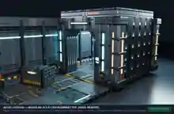
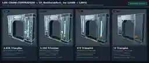

# Sci-Fi modular kit — independent agent trial

> **Historical v0.2.1 lineage.** This directory is retained for release provenance/backwards links and is no longer the canonical v0.2.3+ reproduction path. Use [the canonical source-bound demo](../../demo/SciFiKit/README.md).






*Both previews were downscaled from the supplied agent-created images. Original PNGs and machine reports remain in the independent agent archive.*

**Status:** externally authored demonstration, archive inspected; canonical source/showcase import pending.

An independent agent authored the **Aegis Station** modular environment kit with Blender 5.2.4 and Blender Agent Kit. Unlike the single-asset SupplyCrate, this exercise covers a multi-piece assembly, sockets, nested transform hierarchy, trim-sheet plus emissive material, four LODs, collision proxies, FBX export, and Unity URP packing.

## Supplied source evidence

The author supplied `blender_agent_kit_scifi_demo_evidence.zip` containing two editable Blender scenes, `source/build_scifi_kit.py`, raw 1024² textures, a bulkhead FBX, four packed URP textures, JSON reports (`doctor`, `inspect`, `qa`, `pack`, `export`, LOD metrics), and five rendered proof sheets.

This README records the independent agent's original output. **Do not interpret it as a fresh rebuild or Unity Editor verification.** The full binary archive is not stored in this Git repository yet. This patch includes two original-image-derived lightweight visual previews; a **reproducible public builder rerun and complete image gallery** remain subsequent work.

## Verified from supplied JSON and image files

| Evidence | Result |
| --- | --- |
| Modular assembly | 60 objects, 30 meshes, six piece types |
| Bulkhead visible LOD meshes | 3,628 / 1,260 / 372 / 72 triangles |
| Bulkhead materials | two: trim-sheet and emissive |
| Bulkhead colliders | four meshes |
| Bulkhead snap sockets | five directional empties |
| Bulkhead QA | `passed: true`, zero errors, four UV1 overlap-unverified warnings |
| FBX round-trip | `passed: true`, 5,380 source/export triangles including LODs and colliders, 5,380 imported; no embedded images |
| URP packed maps | four outputs, 1024², 16-bit normal, four standard URP slots |
| Texture evidence | examined actual PNG pixel extrema; files are nonempty |
| Environment | agent's doctor report: Blender 5.2.4 LTS, CPU Cycles |

**Triangle count caveat:** The bulkhead's LOD0 visible mesh is 3,628 triangles. The export inventory reports 3,676 for LOD0 because the four collider meshes contribute 48 triangles; the full exported hierarchy sums to 5,380 triangles. Do not compare these different scopes as if they were the same metric.

## Agent-reported usability feedback

The agent reported that QA exposed non-manifold decimated LODs, an initial material-budget overrun, and pivot drift. It also credited URP map packing and hierarchy-safe FBX export with avoiding custom transformation and packing code. Those *historical corrections* are supported by the agent narrative, **not** by preserved before-and-after machine reports in this archive.

The agent estimated 60–70% savings on pipeline/QA/packing/export effort and 35–45% over the entire exercise, but these are subjective retrospective estimates, not measured benchmarks. Do not put the percentages into marketing claims.

## Stage the original archive without inventing evidence

The included importer validates the exact supplied archive SHA256 and machine reports, copies the canonical raw maps and original reports, converts the **actual** five PNG proof sheets into smaller WebPs, and patches only the builder's original hard-coded working directory to use its containing project directory. It records original and published SHA256 values in `evidence/archive_manifest.json`.

```bash
python -m pip install Pillow
python demos/SciFiKit/import_evidence.py \
  --archive /path/to/blender_agent_kit_scifi_demo_evidence.zip \
  --out demos/SciFiKit
```

To regenerate the geometry after staging, use Blender 5.2+ with:

```bash
blender --factory-startup -b -P demos/SciFiKit/source/build_scifi_kit.py
```

The Blender execution above is an **unverified candidate reproduction command** until it has been run on the ported source. It creates the authoring `.blend` scenes; the supplied JSON reports remain historical evidence, not claims about the new run. Packing, QA, export, and review should be rerun and recorded separately before promoting this to a canonical demonstration.

## Reproduction and provenance

The supplied archive includes the original `source/build_scifi_kit.py` and `.blend` scenes. **Portability finding:** the supplied builder hardcodes `PROJECT_DIR = Path('/working_dir/c_fa16c8b573ce2f34/demo_project')`. This must be replaced with a script-relative or CLI-provided directory before a reproducible public demo is claimed. A public, self-contained reproduction command must not be published until the source, its inputs and assumptions have been brought into the repository and validated end-to-end.

See [reviewed summary](evidence/summary.json). Generic Blender Agent Kit behavior belongs in `shared/`, `tools/`, and target plugins; this environment kit does not define product-level game semantics.
